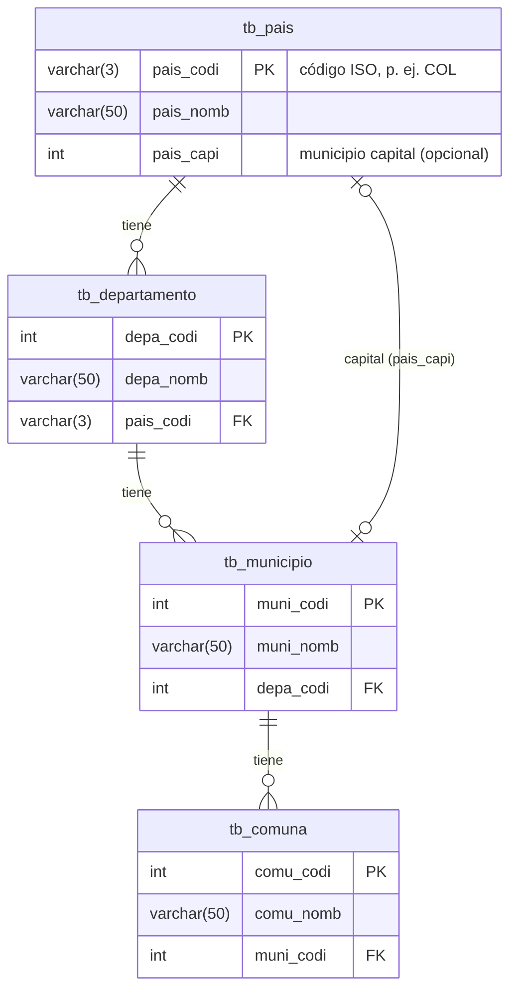

# Personas App

Aplicación web en **Laravel** para administrar la división geográfica de un país:
**países → departamentos → municipios → comunas**, con autenticación de usuarios.

Proyecto académico desarrollado como práctica de Laravel (MVC, Eloquent, Blade y Breeze).

## Funcionalidades

- Registro, inicio de sesión, verificación de correo y perfil de usuario (Laravel Breeze).
- CRUD completo de países, departamentos, municipios y comunas, con búsqueda y paginación.
- Roles: los **administradores** gestionan los catálogos; los **lectores** solo los consultan. Todo usuario nuevo se registra como lector.
- Validación con Form Requests y mensajes en español.
- Integridad referencial: no se puede eliminar un registro que tiene dependientes (p. ej. un país con departamentos).
- Datos de ejemplo de Colombia listos para usar.

## Modelo de datos



## Stack

| Capa | Tecnología |
|---|---|
| Backend | PHP 8.3+, Laravel 13 |
| Autenticación | Laravel Breeze (Blade) |
| Frontend | Blade, Tailwind CSS, Alpine.js, Vite |
| Base de datos | MySQL (desarrollo) · SQLite en memoria (tests) |
| Calidad | PHPUnit, Laravel Pint |

## Requisitos

- PHP **8.3** o superior con las extensiones `pdo_mysql` y `pdo_sqlite`
- Composer 2
- Node.js **20.19** o superior
- MySQL 8 (o MariaDB)

## Instalación

```bash
git clone https://github.com/zemogc/personas-app.git
cd personas-app

composer install
npm install

cp .env.example .env
php artisan key:generate
```

Configura la conexión en `.env` (`DB_DATABASE`, `DB_USERNAME`, `DB_PASSWORD`) y crea la base de datos. Después:

```bash
php artisan migrate --seed   # tablas + datos de ejemplo
npm run build                # o `npm run dev` mientras desarrollas
php artisan serve
```

Abre <http://localhost:8000> e inicia sesión con uno de los usuarios de ejemplo:

| Correo | Contraseña | Rol |
|---|---|---|
| `demo@example.com` | `password` | Administrador |
| `lector@example.com` | `password` | Lector |

## Comandos útiles

| Comando | Descripción |
|---|---|
| `composer test` | Ejecuta la suite de PHPUnit (SQLite en memoria, no requiere MySQL) |
| `composer lint` | Revisa el estilo de código con Pint sin modificar archivos |
| `composer format` | Corrige el estilo de código con Pint |
| `php artisan migrate:fresh --seed` | Reconstruye la base de datos con los datos de ejemplo |
| `php artisan usuario:rol <correo> admin` | Convierte a un usuario en administrador (`lector` para revertirlo) |
| `npm run dev` | Servidor de Vite con recarga en caliente |

La ruta `GET /up` responde 200 cuando la aplicación está sana (útil para monitoreo y balanceadores).

## Estructura relevante

```
app/
├── Http/
│   ├── Controllers/        PaisController, DepartamentoController, MunicipioController, ComunaController
│   └── Requests/           GeografiaRequest (mensajes comunes) y un Form Request por recurso
└── Models/                 Pais, Departamento, Municipio, Comuna (con sus relaciones)
bootstrap/app.php           Rutas, middleware y excepciones (estructura de Laravel 11+)
config/geografia.php        Menú de navegación y registros por página
database/
├── factories/              Factories de cada modelo
├── migrations/             Esquema tb_pais, tb_departamento, tb_municipio, tb_comuna
└── seeders/                GeografiaSeeder (datos de Colombia) y usuario demo
resources/views/
├── components/             flash, select-input y componentes de Breeze
└── {paises,departamentos,municipios,comunas}/   index, new, edit y _form compartido
tests/Feature/Geografia/    Tests del CRUD (CrudConPadreTestCase + un test por recurso)
```

## Flujo de trabajo

- **Ramas**: `tipo/descripcion-corta` (p. ej. `feat/busqueda-municipios`, `fix/validacion-pais`).
- **Commits**: [Conventional Commits](https://www.conventionalcommits.org/es/) en español (`feat:`, `fix:`, `test:`, `docs:`, `chore:`, `build:`, `style:`).
- **Pull requests**: un cambio coherente por PR, que explique el problema, la solución y cómo se verificó.
- Antes de abrir un PR, `composer lint` y `composer test` deben pasar.

## Licencia

Distribuido bajo la licencia [MIT](https://opensource.org/licenses/MIT).
