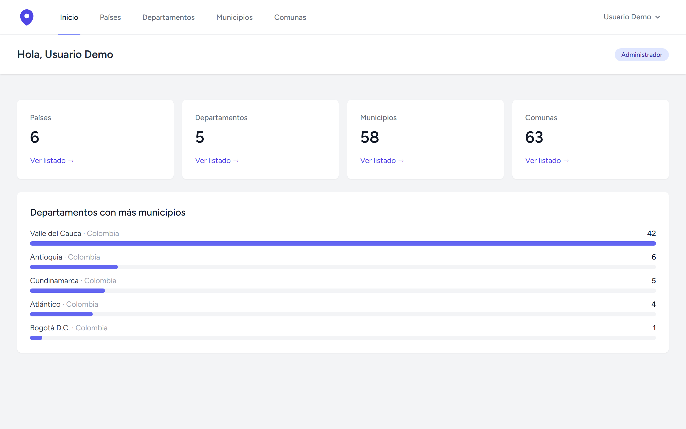
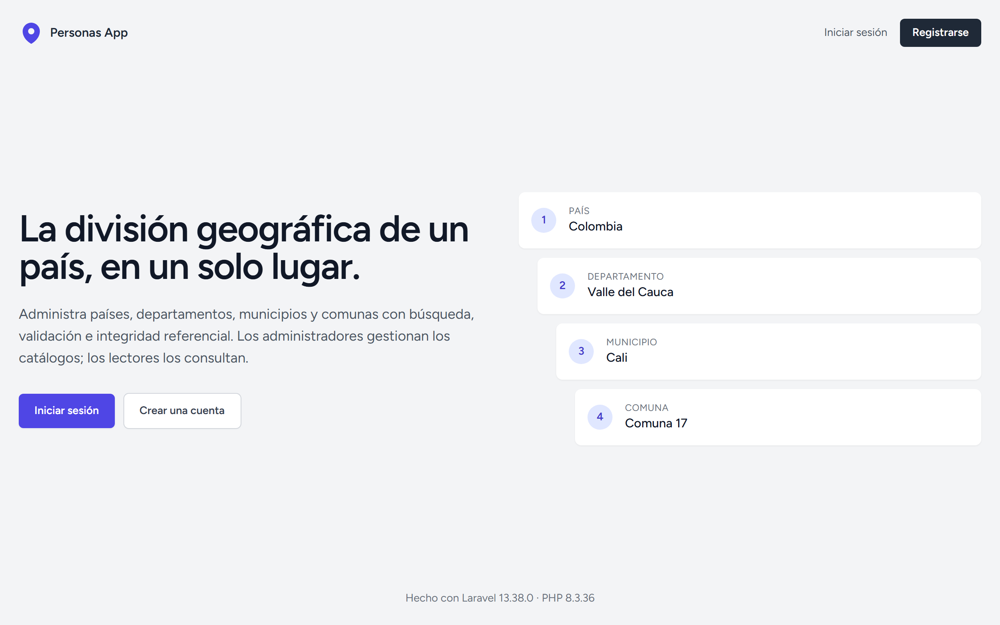
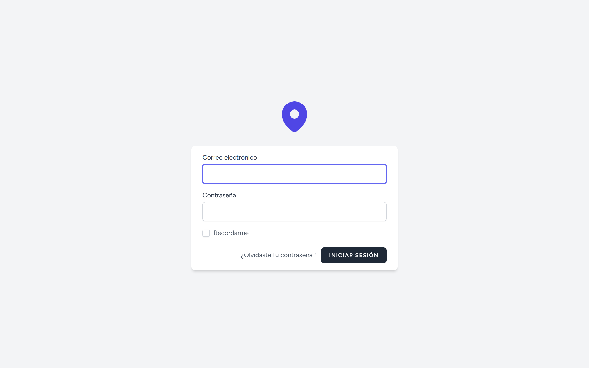
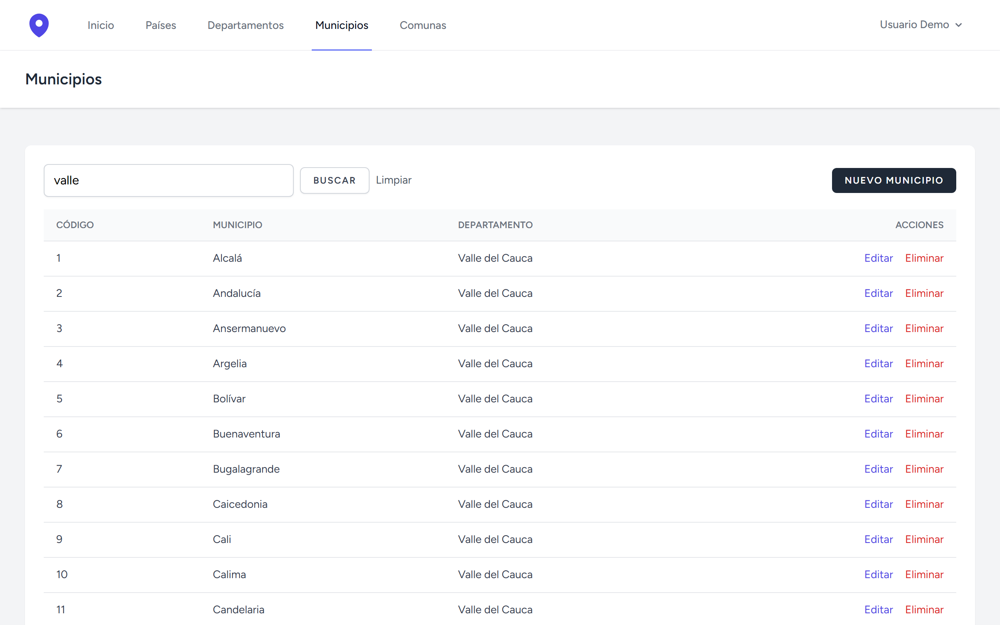
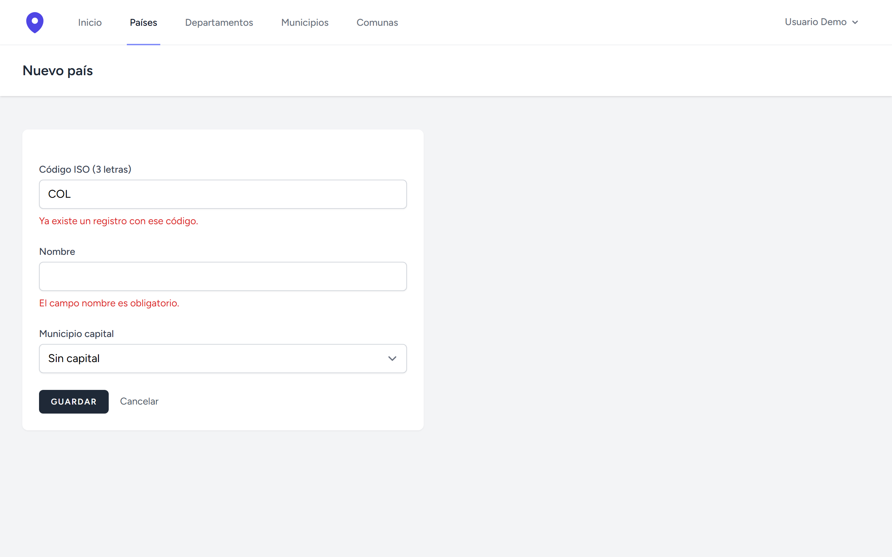
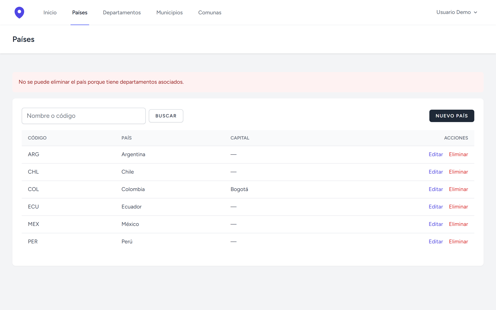
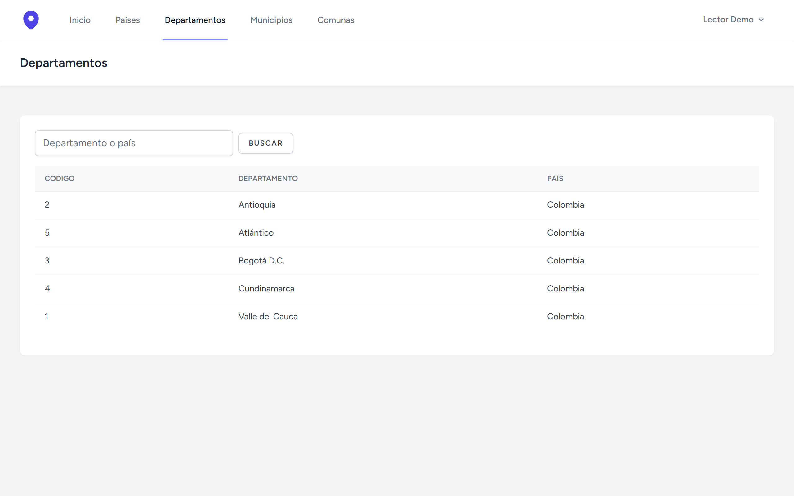
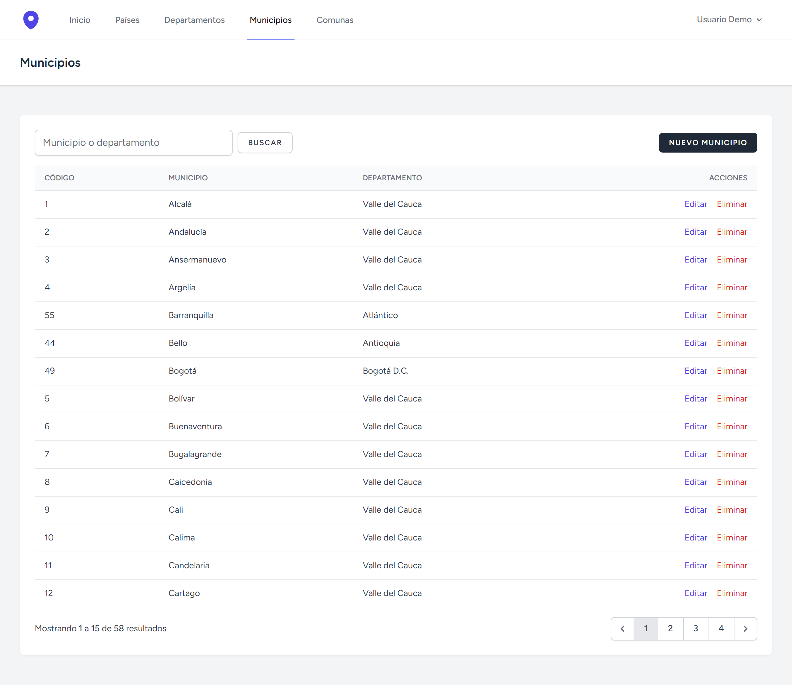
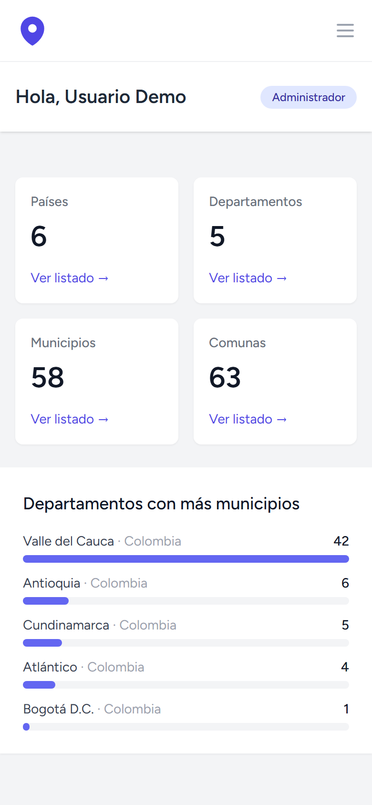
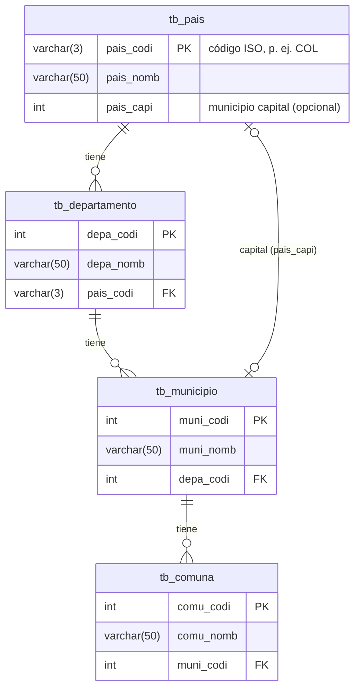

<div align="center">


# Personas App

**La división geográfica de un país, en un solo lugar.**

Aplicación web en Laravel para administrar **países → departamentos → municipios → comunas**,<br>
con búsqueda, roles de usuario e integridad referencial.


[Capturas](#capturas) · [Funcionalidades](#funcionalidades) · [Inicio rápido](#inicio-rápido) · [Pruebas](#pruebas) · [Arquitectura](#arquitectura)

<br>



</div>

## Capturas

<table>
  <tr>
    <td width="50%"><p align="center"><b>Portada</b></p></td>
    <td width="50%"><p align="center"><b>Inicio de sesión en español</b></p></td>
  </tr>
  <tr>
    <td><p align="center"><b>Búsqueda</b>: municipios filtrados por el nombre de su departamento</p></td>
    <td><p align="center"><b>Validación</b> con mensajes por campo</p></td>
  </tr>
  <tr>
    <td><p align="center"><b>Integridad</b>: no se elimina un país con departamentos</p></td>
    <td><p align="center"><b>Rol lector</b>: consulta sin acciones de edición</p></td>
  </tr>
</table>

<details>
<summary><b>Ver listado completo con paginación y vista móvil</b></summary>
<br>
<table>
  <tr>
    <td width="70%"></td>
    <td width="30%"></td>
  </tr>
</table>
</details>

## Funcionalidades

| | |
|---|---|
| 🗺️ **CRUD jerárquico** | Países, departamentos, municipios y comunas, cada uno ligado a su nivel superior mediante selects. |
| 🔎 **Búsqueda y paginación** | Por nombre propio o del nivel superior (p. ej. *"valle"* encuentra los 42 municipios del Valle del Cauca). El filtro se conserva al cambiar de página. |
| 👥 **Roles** | Los **administradores** gestionan los catálogos; los **lectores** solo consultan. Todo usuario nuevo se registra como lector. |
| 🛡️ **Integridad referencial** | Llaves foráneas con `RESTRICT`, y la interfaz explica por qué no se puede borrar un registro con dependientes. |
| ✅ **Validación** | Form Requests con mensajes en español por campo; el código de país se normaliza a mayúsculas. |
| 📊 **Panel** | Totales por catálogo y ranking de departamentos por número de municipios. |
| 🇨🇴 **Datos reales** | El seeder carga municipios, comunas y localidades reales de Colombia. |
| 🔐 **Autenticación** | Registro, inicio de sesión, verificación de correo, recuperación de contraseña y perfil (Laravel Breeze), todo en español. |

## Modelo de datos



## Stack

| Capa | Tecnología |
|---|---|
| Backend | PHP 8.3+, Laravel 13 |
| Autenticación | Laravel Breeze (Blade), Sanctum |
| Frontend | Blade, Tailwind CSS, Alpine.js, Vite 7 |
| Base de datos | MySQL 8 · SQLite en memoria para los tests |
| Calidad | PHPUnit 12, Laravel Pint, Playwright (capturas) |

## Inicio rápido

**Requisitos:** PHP 8.3+ (con `pdo_mysql` y `pdo_sqlite`), Composer 2, Node.js 20.19+ y MySQL 8.

```bash
git clone https://github.com/zemogc/personas-app.git
cd personas-app

composer install
npm install

cp .env.example .env
php artisan key:generate
```

Configura `DB_DATABASE`, `DB_USERNAME` y `DB_PASSWORD` en `.env`, crea la base de datos y luego:

```bash
php artisan migrate --seed   # tablas + datos de ejemplo
npm run build                # o `npm run dev` mientras desarrollas
php artisan serve
```

Abre <http://localhost:8000> e inicia sesión con uno de los usuarios de ejemplo:

| Correo | Contraseña | Rol |
|---|---|---|
| `demo@example.com` | `password` | Administrador |
| `lector@example.com` | `password` | Lector |

> [!TIP]
> Para convertir en administrador a un usuario que se registró desde la web:
> `php artisan usuario:rol correo@ejemplo.com admin`

## Comandos

| Comando | Descripción |
|---|---|
| `composer test` | Ejecuta la suite de PHPUnit (SQLite en memoria, no requiere MySQL) |
| `composer lint` | Revisa el estilo con Laravel Pint sin modificar archivos |
| `composer format` | Corrige el estilo con Laravel Pint |
| `php artisan migrate:fresh --seed` | Reconstruye la base de datos con los datos de ejemplo |
| `php artisan usuario:rol <correo> <admin\|lector>` | Asigna un rol a un usuario |
| `npm run dev` | Servidor de Vite con recarga en caliente |
| `npm run capturas` | Regenera las capturas de este README (requiere la app corriendo con el seeder) |

La ruta `GET /up` responde 200 cuando la aplicación está sana (útil para monitoreo y balanceadores).

## Pruebas

```bash
composer test
```

**101 tests y 302 aserciones** cubren, entre otros:

- CRUD de cada recurso: listado, formularios, creación, validación, edición, eliminación y 404.
- Borrado bloqueado cuando hay registros dependientes.
- Búsqueda por nombre propio y del padre, paginación y escape de comodines de `LIKE` (`%`, `_`).
- Autorización: el lector recibe 403 en cada acción de escritura y no puede asignarse el rol de admin al registrarse.
- Dashboard, portada y textos en español (vistas y mensajes de validación).
- Flujo completo de autenticación de Breeze.

La suite usa SQLite en memoria, pero también pasa contra MySQL 8.4. Para comprobarlo, ejecútala con las variables de una base de datos MySQL de pruebas:

```bash
DB_CONNECTION=mysql DB_DATABASE=personas_test composer test
```

> [!NOTE]
> Vale la pena hacerlo antes de un cambio en el esquema: SQLite no valida la longitud de los `varchar` y MySQL en modo estricto sí. Así se encontró un bug real en un factory.

## Arquitectura

```
app/
├── Console/Commands/AsignarRol.php    php artisan usuario:rol
├── Enums/Rol.php                      admin | lector
├── Http/
│   ├── Controllers/                   Un controlador por recurso + DashboardController
│   └── Requests/                      Un Form Request por recurso (rules + attributes)
├── Models/
│   ├── Concerns/Buscable.php          Scope buscar() reutilizable
│   └── Pais, Departamento, Municipio, Comuna, User
└── Providers/AppServiceProvider.php   Gate 'gestionar-geografia' y rate limiter de la API
bootstrap/app.php                      Rutas, middleware y excepciones (estructura de Laravel 11+)
config/geografia.php                   Menú de navegación y registros por página
database/
├── factories/                         Un factory por modelo
├── migrations/                        Esquema tb_* con llaves foráneas
└── seeders/GeografiaSeeder.php        Datos reales de Colombia
lang/es/, lang/es.json                 Traducciones
resources/views/
├── components/                        flash, search-form, select-input + componentes de Breeze
└── {paises,departamentos,municipios,comunas}/   index, new, edit y un _form compartido
scripts/capturas.mjs                   Genera docs/capturas con Playwright
tests/Feature/Geografia/               CrudConPadreTestCase + un test por recurso + autorización
```

**Decisiones de diseño**

- **Un solo Gate en lugar de cuatro Policies.** Los cuatro catálogos comparten exactamente las mismas reglas de permiso; cuatro Policies idénticas serían duplicación.
- **`rol` fuera de `$fillable`.** El rol solo se asigna de forma explícita (seeder o comando), nunca desde un formulario, para evitar escalada de privilegios por *mass assignment*.
- **Trait `Buscable`.** Cada modelo declara sus columnas buscables, incluidas las de su relación padre con notación de punto (`'pais.pais_nomb'`). El patrón `LIKE` usa `ESCAPE '!'` explícito porque SQLite no tiene carácter de escape por defecto y MySQL usa `\`.
- **Comprobación previa al borrar.** Además de la llave foránea, el controlador revisa si hay dependientes y muestra un mensaje en lugar de un error 500.
- **Clase de test base parametrizada.** `CrudConPadreTestCase` define una vez los casos comunes a los recursos con padre; cada test concreto solo declara modelo, ruta y columnas.

## Flujo de trabajo

- **Ramas:** `tipo/descripcion-corta` (p. ej. `feat/busqueda-municipios`, `fix/validacion-pais`).
- **Commits:** [Conventional Commits](https://www.conventionalcommits.org/es/) en español (`feat:`, `fix:`, `refactor:`, `test:`, `docs:`, `chore:`, `build:`, `style:`).
- **Pull requests:** un cambio coherente por PR, que explique el problema, la solución y cómo se verificó.
- Antes de abrir un PR, `composer lint` y `composer test` deben pasar. Si cambia la interfaz, regenera las capturas con `npm run capturas`.

## Licencia

Distribuido bajo la licencia [MIT](LICENSE).
